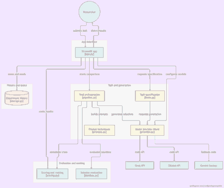

# PromptLab — Prompt Engineering for Code Generation

[](https://github.com/Sahiljain6/promptlab/actions/workflows/ci.yml)

PromptLab is a Streamlit research app for **comparing prompt-engineering techniques for code generation** across Groq and Ollama Cloud. It uses one validated task specification and shared test cases to keep comparisons consistent, scores provider/technique results, and supports Gemini as an optional last-resort backup.

## About

This project supports the study **“A Comparative Study of Prompt Engineering Techniques for Improving Code Generation Accuracy in LLMs.”** Researchers can submit a coding task, run the same prompt techniques against both primary providers, inspect generated code and evaluation results, compare latency and token usage, rank the results, and save/export experiments.

## Architecture



[Open the architecture diagram](docs/architecture.png)

### How the components work together

1. **Streamlit interface — `app.py`**  
   Authenticates users, accepts a coding request or preset task, configures the primary model clients, enforces the app's usage quota, and displays results/history.
2. **Task specification — `promptlab/tasks.py`**  
   Converts a one-line request into a validated entry-point signature, concise behavior description, visible examples, and hidden test cases. It tries Groq first, then Ollama, and uses Gemini only as an optional final fallback if both primary providers fail to produce a valid specification.
3. **Trial orchestration — `promptlab/pipeline.py`**  
   Runs each selected prompt technique against Groq and Ollama using the same specification and test suite. Gemini is not included in normal comparisons; it can be called for a specific technique/trial only if both primary providers return API errors for that same run.
4. **Prompt techniques — `promptlab/prompts.py`**  
   Builds the prompts used by the experiments and extracts the generated function/code.
5. **Model provider client — `promptlab/provider.py`**  
   Sends requests to Groq and OpenAI-compatible endpoints, including Ollama Cloud and Google's Gemini API endpoint.
6. **Evaluation and ranking — `promptlab/sandbox.py` and `promptlab/scoring.py`**  
   Evaluates solutions using the selected safe evaluation mode, annotates trials, flags potentially suspect tests, and ranks provider/technique combinations.
7. **History and quota — `promptlab/storage.py`**  
   Saves experiment history and limits new comparisons per rolling hour on the app instance.

## Features

- **Automatic two-provider comparison:** no model selector is needed for normal Groq + Ollama runs.
- **10 prompt techniques:** zero-shot, few-shot, persona-based, function signature + docstring, structured specification, private planning, chain-of-thought, structured chain-of-thought, decomposition, and self-repair.
- **Shared task specification:** both primary models receive the same behavior specification, examples, and hidden tests for a fair comparison.
- **Resilient specification generation:** tolerant JSON parsing, validation, retries, truncation recovery, and ordered provider fallback.
- **Optional Gemini backup:** used only after both primary providers fail in the specified fallback cases; the API key is optional.
- **Evaluation and ranking:** accuracy/solved rate, latency, token usage, available execution timing, configurable score weights, and best-response selection.
- **Experiment history and exports:** review saved runs and download comparison data as CSV or JSON.
- **Security controls:** app access password, server-side API secrets, provider-error redaction, request/trial limits, and guarded execution modes.

## Provider and fallback behavior

### Task specification

For a custom one-line request, PromptLab follows this order:

1. **Groq** attempts to create a valid task specification.
2. If Groq fails, **Ollama Cloud** attempts to create it.
3. If both primary providers fail and `GEMINI_API_KEY` is configured, **Gemini** is tried as a last resort.

The validated specification is then shared by the coding models.

### Code generation

Under normal circumstances, PromptLab sends each selected technique to **Groq and Ollama**. Gemini remains idle. For an individual technique/trial, Gemini is called only when both primary provider runs return an API error. An empty response is treated as an API error. A provider response that generates code but fails evaluation does not, by itself, trigger Gemini.

## Configuration

Keep real credentials in Streamlit Secrets or a local `.env` file. Never commit real API keys.

### Streamlit Community Cloud

In the app dashboard, open **Settings → Secrets** and configure:

```toml
GROQ_API_KEY = "your-groq-api-key"
OLLAMA_API_KEY = "your-ollama-cloud-api-key"
PROMPTLAB_ACCESS_PASSWORD = "replace-with-a-long-random-password"

# Optional: Gemini is a last-resort backup, not a normal comparison model.
GEMINI_API_KEY = "your-gemini-api-key"
```

The app remains locked until `PROMPTLAB_ACCESS_PASSWORD` is configured. Do not share this password publicly; also restrict the deployed app to its intended audience.

### Model and application settings

These values are optional and have server-side defaults:

```dotenv
GROQ_MODEL=openai/gpt-oss-20b
OLLAMA_MODEL=gpt-oss:20b-cloud
OLLAMA_BASE_URL=https://ollama.com/v1
GEMINI_MODEL=gemini-3.8-flash
GROQ_TEST_MODEL=openai/gpt-oss-20b
PROMPTLAB_MAX_RUNS_PER_HOUR=6
PROMPTLAB_ENABLE_DOCKER_EXECUTION=false
```

If the default Ollama model is not available to your account, set `OLLAMA_MODEL` to a model that your Ollama account can access. Ollama Cloud uses its OpenAI-compatible endpoint at `https://ollama.com/v1` and the `OLLAMA_API_KEY` secret. See [Ollama's OpenAI compatibility documentation](https://github.com/ollama/ollama/blob/main/docs/api/openai-compatibility.mdx).

## Run locally on Windows

Recommended setup uses Python 3.12, matching the project's CI environment.

1. Clone or download this repository and open PowerShell in the project folder.
2. Create and activate a virtual environment:

   ```powershell
   py -3.12 -m venv .venv
   .\.venv\Scripts\Activate.ps1
   ```

3. Install the dependencies:

   ```powershell
   python -m pip install --upgrade pip
   pip install -r requirements.txt
   ```

4. Copy `.env.example` to `.env`, then add your API keys and a long random `PROMPTLAB_ACCESS_PASSWORD`. Leave `GEMINI_API_KEY` blank unless you want the optional backup:

   ```powershell
   Copy-Item .env.example .env
   ```

5. Start the app:

   ```powershell
   python -m streamlit run app.py
   ```

6. Open the local URL printed in the terminal, typically `http://localhost:8501`.

For a local Ollama server, you can set `OLLAMA_BASE_URL=http://localhost:11434/v1` and `OLLAMA_API_KEY=ollama`. Use this only for local development. In a cloud deployment, `localhost` refers to the app container, not your computer.

## Evaluation and execution safety

- **AI estimate (default):** Groq estimates likely test outcomes from the code and test cases. It does not execute the generated Python, so estimates must not be reported as verified pass rates.
- **Docker sandbox:** actual code execution is offered only when Docker is available and the app owner explicitly sets `PROMPTLAB_ENABLE_DOCKER_EXECUTION=true`. The sandbox uses defensive isolation settings, resource limits, and timeouts.
- **Host-local Python:** host-local subprocess execution is not offered in the hosted UI. The developer-only path remains guarded by `PROMPTLAB_ALLOW_UNSAFE_LOCAL_EXECUTOR=true`; do not enable it for a public deployment.
- **No unsafe auto fallback:** automatic evaluation does not fall back to running generated code directly on the host when Docker is unavailable.

Generated code is untrusted. For a hosted demo, prefer AI-estimate mode or review the Docker isolation and deployment configuration before enabling actual execution.

## Scoring

The default composite score is:

```text
score = 100 × (
    0.70 × accuracy
  + 0.10 × speed
  + 0.10 × token efficiency
  + 0.10 × execution efficiency
)
```

The app also supports **Balanced** and **Speed & cost first** weighting. Results distinguish valid trials from API errors and unavailable evaluations. A test case failed by every candidate may be flagged as potentially suspect; review such cases instead of automatically assuming the expected value is wrong.

## Run tests

Run the full test suite from the repository root:

```bash
python -m unittest discover -s tests -v
```

Continuous integration compiles the application, runs unit/security regression tests, and audits installed dependencies. The latest verified run passed all 39 tests and the dependency audit: [view GitHub Actions](https://github.com/Sahiljain6/promptlab/actions/workflows/ci.yml).

## Troubleshooting

- **Missing key:** check Streamlit Secrets or local `.env`. The two primary keys and `PROMPTLAB_ACCESS_PASSWORD` are required; `GEMINI_API_KEY` is optional.
- **Custom task cannot create a specification:** try simplifying the request, which is limited to 500 characters. Check provider access and model IDs. PromptLab validates/retries the generated JSON and tries providers in the order described above.
- **Gemini did not run:** this is expected when a primary provider succeeds. Gemini is intentionally not called for routine comparisons or merely because generated code fails its tests.
- **No actual execution results:** the app defaults to AI-estimate mode. Docker execution must be enabled by the app owner and available at runtime.
- **Quota reached:** the default rolling-hour quota is six comparisons per app instance and can be adjusted with `PROMPTLAB_MAX_RUNS_PER_HOUR` up to the app's configured cap.

JSON mode and response recovery improve reliability but cannot guarantee the mathematical correctness of generated test expectations. Validate the test suite independently for research-grade results.

## Reusable prompt-engineering skill

PromptLab now also includes a **portable prompt-engineering skill** that other compatible AI agents can reuse to turn ordinary requests into clear, actionable prompts. It is separate from the Streamlit code-generation research app and does not require API keys or a specific model.

- [Skill quick start](skills/prompt-engineering/README.md)
- [Core agent instructions](skills/prompt-engineering/SKILL.md)
- [Technique selection guide and review rubric](skills/prompt-engineering/references/technique-selection.md)
- [Before/after examples](skills/prompt-engineering/examples/transformations.md)
- [Integration guidance](docs/skill-integration.md)

The skill preserves user intent and constraints, chooses techniques based on the task, defines output and acceptance criteria where useful, and emphasizes safety and honest verification. Agent compatibility depends on the target platform's supported skill-loading format.

## Repository structure

- `app.py` — Streamlit UI, access control, provider configuration, comparison flow, charts, and exports.
- `promptlab/prompts.py` — prompt templates and code extraction.
- `promptlab/tasks.py` — custom task specification generation, parsing/recovery, and preset tasks.
- `promptlab/pipeline.py` — concurrent trial orchestration, code generation, optional fallback, and self-repair.
- `promptlab/provider.py` — Groq and OpenAI-compatible provider API calls.
- `promptlab/sandbox.py` — AI-estimate evaluation and guarded execution modes.
- `promptlab/scoring.py` — scoring, suspect-test annotations, ranking, and best-response selection.
- `promptlab/storage.py` — experiment history and usage quota.
- `docs/architecture.png` — architecture diagram displayed above.
- `tests/` — unit and security regression tests, including Gemini fallback-order coverage.
